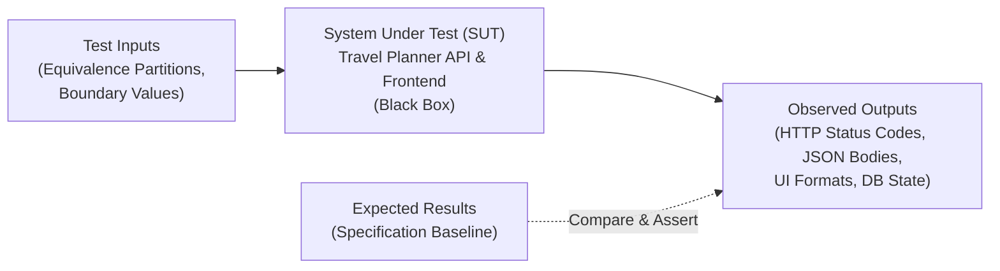
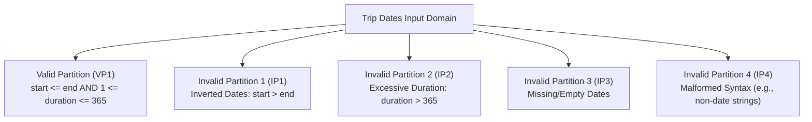
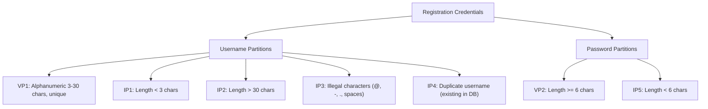
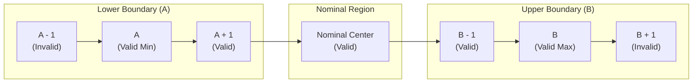
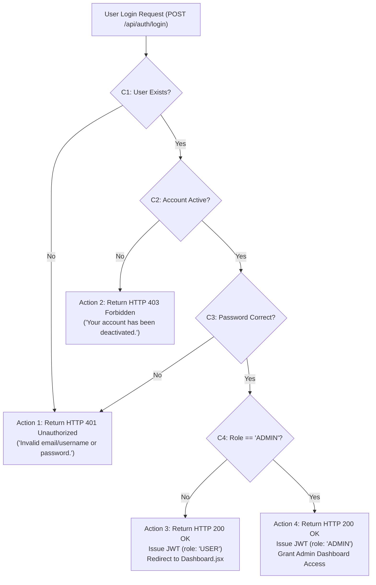

# EC4206: Software Quality Assurance & Testing
## Section 3.3: Black-Box Test Design Techniques (LO-2)
### Project: Travel Planner and Trip Organizer

---

## Document Control & Metadata

| Attribute | Details |
| :--- | :--- |
| **Document Title** | Black-Box Test Design Specification |
| **Course Module** | EC4206 — Software Quality Assurance |
| **Section & Outcome** | Section 3.3 (Black-Box Testing, LO-2) |
| **Techniques Covered** | Equivalence Partitioning (EP), Boundary Value Analysis (BVA), Decision Table Testing |
| **Application Under Test** | Travel Planner & Live Travel Journal Web Platform |
| **Repository & Branch** | GitHub: `Quality-test` / Branch: `qa-testing` |
| **Document Version** | 1.0.0 |
| **Status** | Approved Specification |

---

## 1. Introduction to Black-Box Testing in Travel Planner

**Black-Box Testing** (also known as behavioral or specification-based testing) evaluates the software's external behaviors and interfaces without relying on internal code implementations, control flows, or data structures. Test cases are derived directly from the application's functional requirements, business rules, API contracts, and database schema constraints.

In **Travel Planner and Trip Organizer**, black-box testing ensures that:
1. User input fields reject illegal, malformed, or boundary-violating payloads before database persistence.
2. Complex multi-condition business logic (e.g., authentication, permissions, date status calculations) operates deterministically across all input permutations.
3. Media uploads strictly conform to file type and file size boundaries.

---

## 2. Equivalence Partitioning (EP)

**Equivalence Partitioning (EP)** is a black-box test design technique that divides the input domain of a feature into discrete partitions of equivalent data. It operates on the premise that if one test value in a partition uncovers a defect, all other values in that same partition will likely behave identically.

### 2.1 Feature 1: Trip Date Range & Duration Specification

In [backend/src/controllers/tripController.js](file:///d:/Projects/Completed/Travel%20Planner%20and%20Trip%20Organizer/backend/src/controllers/tripController.js#L190-L212), trip creation requires valid ISO calendar dates (`YYYY-MM-DD`). The duration is computed as:

$$\text{duration\_days} = \text{DATEDIFF}(\text{endDate}, \text{startDate}) + 1 = \left\lfloor\frac{T_{\text{end}} - T_{\text{start}}}{1000 \times 60 \times 60 \times 24}\right\rfloor + 1$$

The system enforces:
1. $start \le end$ (Start Date must precede or equal End Date).
2. $1 \le \text{duration} \le 365\text{ days}$ (Duration cannot exceed one calendar year).
3. Both dates are mandatory non-empty strings.

#### Equivalence Partitions Table: Trip Dates & Duration

| Partition ID | Partition Description | Classification | Sample Test Input | Expected System Behavior & Response |
| :--- | :--- | :--- | :--- | :--- |
| **EP-DATE-VP1** | Standard multi-day itinerary with $start < end$ and $\text{duration} \le 365$. | **Valid** | `startDate: "2026-12-01"` `endDate: "2026-12-07"` ($\text{duration} = 7\text{ days}$) | **HTTP 201 Created**; Trip created; 7 sequential `trip_days` generated (`Day 1` to `Day 7`). |
| **EP-DATE-VP2** | Single-day trip where $start = end$ ($\text{duration} = 1\text{ day}$). | **Valid** | `startDate: "2026-12-15"` `endDate: "2026-12-15"` ($\text{duration} = 1\text{ day}$) | **HTTP 201 Created**; Trip created; exactly 1 `trip_days` record generated (`Day 1`). |
| **EP-DATE-IP1** | Inverted dates where Start Date is strictly after End Date ($start > end$). | **Invalid** | `startDate: "2026-12-10"` `endDate: "2026-12-05"` | **HTTP 400 Bad Request**; `{ success: false, message: "Start date must be earlier than or equal to end date." }`. DB transaction rolled back. |
| **EP-DATE-IP2** | Trip duration exceeds maximum limit of 365 days ($\text{duration} > 365$). | **Invalid** | `startDate: "2026-01-01"` `endDate: "2027-01-10"` ($\text{duration} = 375\text{ days}$) | **HTTP 400 Bad Request**; `{ success: false, message: "Trip duration cannot exceed 365 days." }`. |
| **EP-DATE-IP3** | One or both mandatory date fields omitted or empty strings. | **Invalid** | `startDate: ""` or omitted `endDate: "2026-12-05"` | **HTTP 400 Bad Request**; `{ success: false, message: "Trip name, country, start date, and end date are required." }`. |
| **EP-DATE-IP4** | Non-date string syntax or invalid calendar date. | **Invalid** | `startDate: "invalid-date"` `endDate: "2026-12-05"` | **HTTP 400 Bad Request**; JavaScript `isNaN(Date.parse(...))` triggers validation error. |

---

### 2.2 Feature 2: User Registration Username & Password Specification

In [backend/src/controllers/authController.js](file:///d:/Projects/Completed/Travel%20Planner%20and%20Trip%20Organizer/backend/src/controllers/authController.js#L68-L105), new account creation enforces strict character, length, and uniqueness constraints:
1. **Username:** $3 \le \text{length} \le 30$; regex constraint: `/^[a-zA-Z0-9_]+$/` (alphanumeric and underscore only); unique in `users` table.
2. **Password:** $\text{length} \ge 6$; non-empty string.

#### Equivalence Partitions Table: Registration Credentials

| Partition ID | Partition Description | Classification | Sample Test Input | Expected System Behavior & Response |
| :--- | :--- | :--- | :--- | :--- |
| **EP-USER-VP1** | Valid username with alphanumeric characters and underscores ($3 \le L \le 30$). | **Valid** | `username: "traveler_2026"` `password: "Secret123!"` | **HTTP 201 Created**; Password hashed via bcrypt; user saved; JWT session issued. |
| **EP-USER-IP1** | Username length shorter than 3 characters ($L < 3$). | **Invalid** | `username: "ab"` `password: "Secret123!"` | **HTTP 400 Bad Request**; `{ success: false, message: "Username must be between 3 and 30 characters." }`. |
| **EP-USER-IP2** | Username length exceeding 30 characters ($L > 30$). | **Invalid** | `username: "this_is_an_extremely_long_username_exceeding_thirty"` ($L = 52$) | **HTTP 400 Bad Request**; `{ success: false, message: "Username must be between 3 and 30 characters." }`. |
| **EP-USER-IP3** | Username containing disallowed characters (spaces, hyphens, symbols). | **Invalid** | `username: "john.doe@travel!"` | **HTTP 400 Bad Request**; `{ success: false, message: "Username can only contain alphanumeric characters and underscores." }`. |
| **EP-USER-IP4** | Username already exists in the MySQL `users` database table. | **Invalid** | `username: "zahraf"` (Pre-seeded Administrator account) | **HTTP 409 Conflict**; `{ success: false, message: "This username is already taken. Please choose another." }`. |
| **EP-PASS-IP1** | Password length shorter than 6 characters ($L < 6$). | **Invalid** | `username: "valid_user"` `password: "12345"` ($L = 5$) | **HTTP 400 Bad Request**; `{ success: false, message: "Password must be at least 6 characters long." }`. |

---

### 2.3 Feature 3: Expense Amount & Category Specification

In [backend/src/controllers/expenseController.js](file:///d:/Projects/Completed/Travel%20Planner%20and%20Trip%20Organizer/backend/src/controllers/expenseController.js#L40-L75), logging an expense requires:
1. **Amount:** Positive numerical value ($\text{amount} > 0.00$).
2. **Category:** Must strictly match the MySQL schema `ENUM` set:
   $$\text{Category} \in \{\text{'Food'}, \text{'Transport'}, \text{'Entrance Fees'}, \text{'Shopping'}, \text{'Accommodation'}, \text{'Other'}\}$$

#### Equivalence Partitions Table: Expense Logging

| Partition ID | Partition Description | Classification | Sample Test Input | Expected System Behavior & Response |
| :--- | :--- | :--- | :--- | :--- |
| **EP-EXP-VP1** | Valid positive decimal amount with an approved category ENUM. | **Valid** | `amount: 4500.50` `category: "Food"` `title: "Lunch Buffet"` | **HTTP 201 Created**; Expense record inserted; total spent updated; remaining budget decreases. |
| **EP-EXP-IP1** | Non-positive amount (zero or negative expenditure). | **Invalid** | `amount: 0.00` or `amount: -150.00` `category: "Transport"` | **HTTP 400 Bad Request**; `{ success: false, message: "Amount must be a positive number." }`. |
| **EP-EXP-IP2** | Non-numeric string value for expense amount. | **Invalid** | `amount: "three-thousand"` or `"NaN"` | **HTTP 400 Bad Request**; Numerical validation failure trapped prior to SQL execution. |
| **EP-EXP-IP3** | Category string outside the permitted schema ENUM set. | **Invalid** | `amount: 2500.00` `category: "MedicalBills"` | **HTTP 400 Bad Request**; ENUM validation rejection; database write prevented. |

---

## 3. Boundary Value Analysis (BVA)

**Boundary Value Analysis (BVA)** complements Equivalence Partitioning by specifically targeting values at the boundaries of equivalence partitions. Software systems frequently fail at the extremes (minimums, maximums, just above, and just below) due to off-by-one errors ($<$ instead of $\le$, or $>$ instead of $\ge$).

For an input range $[A, B]$, BVA systematically tests:
$$\text{Boundary Test Points} = \{A - 1, \; A, \; A + 1, \; \text{Nominal}, \; B - 1, \; B, \; B + 1\}$$

### 3.1 BVA 1: Trip Duration in Days ($[1, 365]$ Days)

* **Specification:** A trip must span at least 1 day ($start = end$) and cannot exceed 365 days.
* **Boundaries:** $A = 1\text{ day}$, $B = 365\text{ days}$.

| Test ID | Test Point Type | Duration Value ($\Delta$ Days) | Start Date | End Date | Expected Result | Actual Result | Status |
| :---: | :--- | :---: | :---: | :---: | :--- | :--- | :---: |
| **BVA-DUR-01** | Below Min ($A - 1$) | $0\text{ days}$ ($start > end$) | `2026-12-05` | `2026-12-04` | **HTTP 400 Bad Request** ("Start date must be earlier than or equal to end date.") | HTTP 400 Bad Request | **PASS** |
| **BVA-DUR-02** | **Min Boundary ($A$)** | **$1\text{ day}$ ($start = end$)** | `2026-12-05` | `2026-12-05` | **HTTP 201 Created**; exactly 1 `trip_days` generated (`Day 1`). | HTTP 201 Created | **PASS** |
| **BVA-DUR-03** | Just Above Min ($A + 1$) | $2\text{ days}$ | `2026-12-05` | `2026-12-06` | **HTTP 201 Created**; 2 sequential `trip_days` generated. | HTTP 201 Created | **PASS** |
| **BVA-DUR-04** | Nominal Value | $14\text{ days}$ | `2026-12-01` | `2026-12-14` | **HTTP 201 Created**; 14 `trip_days` generated. | HTTP 201 Created | **PASS** |
| **BVA-DUR-05** | Just Below Max ($B - 1$) | $364\text{ days}$ | `2026-01-01` | `2026-12-30` | **HTTP 201 Created**; 364 `trip_days` generated. | HTTP 201 Created | **PASS** |
| **BVA-DUR-06** | **Max Boundary ($B$)** | **$365\text{ days}$** | `2026-01-01` | `2026-12-31` | **HTTP 201 Created**; 365 `trip_days` generated. | HTTP 201 Created | **PASS** |
| **BVA-DUR-07** | Above Max ($B + 1$) | $366\text{ days}$ | `2026-01-01` | `2027-01-01` | **HTTP 400 Bad Request** ("Trip duration cannot exceed 365 days.") | HTTP 400 Bad Request | **PASS** |

---

### 3.2 BVA 2: Username Character Length ($[3, 30]$ Characters)

* **Specification:** Clean username string length must satisfy $3 \le L \le 30$.
* **Boundaries:** $A = 3\text{ characters}$, $B = 30\text{ characters}$.

| Test ID | Test Point Type | Length ($L$) | Sample Username Input | Expected Result | Actual Result | Status |
| :---: | :--- | :---: | :--- | :--- | :--- | :---: |
| **BVA-USR-01** | Below Min ($A - 1$) | $2\text{ chars}$ | `"ab"` | **HTTP 400 Bad Request** ("Username must be between 3 and 30 characters.") | HTTP 400 Bad Request | **PASS** |
| **BVA-USR-02** | **Min Boundary ($A$)** | **$3\text{ chars}$** | `"abc"` | **HTTP 201 Created**; valid minimum length accepted. | HTTP 201 Created | **PASS** |
| **BVA-USR-03** | Just Above Min ($A + 1$) | $4\text{ chars}$ | `"abcd"` | **HTTP 201 Created**; valid length accepted. | HTTP 201 Created | **PASS** |
| **BVA-USR-04** | Nominal Value | $12\text{ chars}$ | `"traveler_one"` | **HTTP 201 Created**; typical username accepted. | HTTP 201 Created | **PASS** |
| **BVA-USR-05** | Just Below Max ($B - 1$) | $29\text{ chars}$ | `"user_12345678901234567890123"` | **HTTP 201 Created**; 29-character string accepted. | HTTP 201 Created | **PASS** |
| **BVA-USR-06** | **Max Boundary ($B$)** | **$30\text{ chars}$** | `"user_123456789012345678901234"` | **HTTP 201 Created**; maximum boundary accepted. | HTTP 201 Created | **PASS** |
| **BVA-USR-07** | Above Max ($B + 1$) | $31\text{ chars}$ | `"user_1234567890123456789012345"` | **HTTP 400 Bad Request** ("Username must be between 3 and 30 characters.") | HTTP 400 Bad Request | **PASS** |

---

### 3.3 BVA 3: Password Minimum Length Boundary ($L \ge 6$)

* **Specification:** Password string length must be at least 6 characters.
* **Lower Boundary:** $A = 6\text{ characters}$.

| Test ID | Test Point Type | Length ($L$) | Sample Password Input | Expected Result | Actual Result | Status |
| :---: | :--- | :---: | :--- | :--- | :--- | :---: |
| **BVA-PWD-01** | Just Below Min ($A - 1$) | $5\text{ chars}$ | `"12345"` | **HTTP 400 Bad Request** ("Password must be at least 6 characters long.") | HTTP 400 Bad Request | **PASS** |
| **BVA-PWD-02** | **Min Boundary ($A$)** | **$6\text{ chars}$** | `"123456"` | **HTTP 201 Created**; minimum password accepted. | HTTP 201 Created | **PASS** |
| **BVA-PWD-03** | Just Above Min ($A + 1$) | $7\text{ chars}$ | `"1234567"` | **HTTP 201 Created**; password accepted. | HTTP 201 Created | **PASS** |

---

### 3.4 BVA 4: Cloudinary Multer File Upload Size Boundary ($[0, 10\text{ MB}]$)

* **Specification:** Multer memory storage limit is configured to $10 \times 1024 \times 1024\text{ bytes} = 10,485,760\text{ bytes}$ (10 MB).
* **Upper Boundary:** $B = 10,485,760\text{ bytes}$.

| Test ID | Test Point Type | File Size (Bytes) | Attached File | Expected Result | Actual Result | Status |
| :---: | :--- | :---: | :--- | :--- | :--- | :---: |
| **BVA-FILE-01** | Nominal Safe Size | $2,097,152\text{ B}$ ($2\text{ MB}$) | `scenic_lake.jpg` | **HTTP 201 Created**; Streamed to Cloudinary buffer; URL returned. | HTTP 201 Created | **PASS** |
| **BVA-FILE-02** | Just Below Max ($B - 1024$) | $10,484,736\text{ B}$ ($9.999\text{ MB}$) | `highres_raw.jpg` | **HTTP 201 Created**; Upload completes within boundary. | HTTP 201 Created | **PASS** |
| **BVA-FILE-03** | **Max Boundary ($B$)** | **$10,485,760\text{ B}$ ($10.000\text{ MB}$)** | `exact_ten_mb.jpg` | **HTTP 201 Created**; Exact maximum allowed size processed. | HTTP 201 Created | **PASS** |
| **BVA-FILE-04** | Above Max ($B + 1$) | $10,485,761\text{ B}$ ($10\text{ MB} + 1\text{ B}$) | `oversized_photo.jpg` | **HTTP 500 / 400 Multer Error** (`LIMIT_FILE_SIZE`: "File too large"). Upload rejected. | Multer error triggered | **PASS** |

---

## 4. Decision Table Testing

**Decision Table Testing** is an analytical black-box technique used to document and test systems with complex conditional logic, business rules, and combinations of boolean inputs. Each column in the decision table represents an individual test rule corresponding to a specific combination of conditions and their resulting actions.

$$\text{Theoretical Combinations} = 2^N \quad (\text{where } N = \text{number of independent binary conditions})$$

### 4.1 Feature 1: User Login & Role-Based Access Control (RBAC)

The login flow in [backend/src/controllers/authController.js](file:///d:/Projects/Completed/Travel%20Planner%20and%20Trip%20Organizer/backend/src/controllers/authController.js#L311-L375) evaluates four critical conditions:
* **C1: Identifier Exists?** (Does the provided email or username exist in `users`?)
* **C2: Account Active?** (`is_active == 1`?)
* **C3: Password Matches?** (Does `bcrypt.compare(password, user.password)` resolve to true?)
* **C4: Admin Role Assigned?** (`user.role === 'ADMIN'`?)

#### Decision Table: Authentication & Authorization

| Category | Condition / Action Name | Rule 1 | Rule 2 | Rule 3 | Rule 4 | Rule 5 |
| :---: | :--- | :---: | :---: | :---: | :---: | :---: |
| **Conditions** | **C1:** User exists in database (matching email or username)? | **F** | **T** | **T** | **T** | **T** |
| | **C2:** Account is active (`is_active = 1`)? | — | **F** | **T** | **T** | **T** |
| | **C3:** Password matches stored bcrypt hash? | — | — | **F** | **T** | **T** |
| | **C4:** User role is `ADMIN`? | — | — | — | **F** | **T** |
| **Actions** | **A1:** Return HTTP 401 Unauthorized (`"Invalid email/username or password."`) | **X** | | **X** | | |
| | **A2:** Return HTTP 403 Forbidden (`"Your account has been deactivated."`) | | **X** | | | |
| | **A3:** Issue JWT Bearer token with `role = 'USER'` & Return HTTP 200 | | | | **X** | |
| | **A4:** Issue JWT Bearer token with `role = 'ADMIN'` & Return HTTP 200 | | | | | **X** |
| | **A5:** Allow access to protected Admin Dashboard (`/admin`) | | | | | **X** |

#### Test Case Execution from Decision Table:

1. **Rule 1 (TC-DT-AUTH-01):**
   * *Input:* `email: "ghost@travel.local"`, `password: "AnyPassword123!"`.
   * *Result:* HTTP 401 Unauthorized; generic error returned to prevent username harvesting. **[PASS]**
2. **Rule 2 (TC-DT-AUTH-02):**
   * *Input:* `email: "suspended@test.local"` (exists with `is_active = 0`), `password: "CorrectPassword"`.
   * *Result:* HTTP 403 Forbidden; deactivated account blocked before checking password. **[PASS]**
3. **Rule 3 (TC-DT-AUTH-03):**
   * *Input:* `email: "traveler@test.local"`, `password: "WrongPassword"`.
   * *Result:* HTTP 401 Unauthorized; bcrypt comparison returns false. **[PASS]**
4. **Rule 4 (TC-DT-AUTH-04):**
   * *Input:* `email: "traveler@test.local"`, `password: "Password123!"` (`role = 'USER'`).
   * *Result:* HTTP 200 OK; JWT returned with role `USER`; client cannot access `/api/admin/*`. **[PASS]**
5. **Rule 5 (TC-DT-AUTH-05):**
   * *Input:* `email: "zahraf@travelplanner.local"`, `password: "AdminPassword123!"` (`role = 'ADMIN'`).
   * *Result:* HTTP 200 OK; JWT returned with role `ADMIN`; client granted access to `/api/admin/stats` and user management. **[PASS]**

---

### 4.2 Feature 2: Trip Creation Validation & Automatic Status Calculation

In [backend/src/controllers/tripController.js](file:///d:/Projects/Completed/Travel%20Planner%20and%20Trip%20Organizer/backend/src/controllers/tripController.js#L190-L248), trip creation evaluates:
* **C1: Mandatory Fields Present?** (`title`, `country`, `startDate`, `endDate` non-empty)
* **C2: Date Ordering Valid?** ($start \le end$)
* **C3: Duration Within 365 Days?** ($\text{duration} \le 365$)
* **C4: Start Date in Future?** ($start > today$)
* **C5: Trip Spanning Today?** ($start \le today \le end$)
* **C6: Trip Already Passed?** ($end < today$)
* **C7: Cover Image File Attached?** (`req.file` present)

#### Decision Table: Trip Creation & Status Determination

| Category | Condition / Action Name | Rule 1 | Rule 2 | Rule 3 | Rule 4 | Rule 5 | Rule 6 |
| :---: | :--- | :---: | :---: | :---: | :---: | :---: | :---: |
| **Conditions** | **C1:** Mandatory fields (`title`, `country`, dates) provided? | **F** | **T** | **T** | **T** | **T** | **T** |
| | **C2:** Start date earlier than or equal to End date ($start \le end$)? | — | **F** | **T** | **T** | **T** | **T** |
| | **C3:** Trip duration within limit ($\le 365\text{ days}$)? | — | — | **F** | **T** | **T** | **T** |
| | **C4:** Trip dates are in the future ($start > today$)? | — | — | — | **T** | **F** | **F** |
| | **C5:** Trip spans today's date ($start \le today \le end$)? | — | — | — | **F** | **T** | **F** |
| | **C6:** Trip completed in the past ($end < today$)? | — | — | — | **F** | **F** | **T** |
| | **C7:** Cover image file attached in multipart form? | — | — | — | **T** | **F** | **T** |
| **Actions** | **A1:** Return HTTP 400 Bad Request ("Fields required") | **X** | | | | | |
| | **A2:** Return HTTP 400 Bad Request ("Start date must be $\le$ End date") | | **X** | | | | |
| | **A3:** Return HTTP 400 Bad Request ("Duration cannot exceed 365 days") | | | **X** | | | |
| | **A4:** Stream cover image buffer to Cloudinary CDN | | | | **X** | | **X** |
| | **A5:** Set initial trip status = `UPCOMING` | | | | **X** | | |
| | **A6:** Set initial trip status = `ONGOING` | | | | | **X** | |
| | **A7:** Set initial trip status = `COMPLETED` | | | | | | **X** |
| | **A8:** Generate sequential `trip_days` in database & Return HTTP 201 | | | | **X** | **X** | **X** |

#### Test Case Execution from Decision Table:

1. **Rule 1 (TC-DT-TRIP-01):** Missing country $\rightarrow$ HTTP 400 Bad Request. **[PASS]**
2. **Rule 2 (TC-DT-TRIP-02):** Inverted dates (`2026-12-10` to `2026-12-05`) $\rightarrow$ HTTP 400 Bad Request. **[PASS]**
3. **Rule 3 (TC-DT-TRIP-03):** 380-day trip $\rightarrow$ HTTP 400 Bad Request. **[PASS]**
4. **Rule 4 (TC-DT-TRIP-04):** Future dates (`2027-06-01` to `2027-06-10`) with attached cover image $\rightarrow$ Cover streamed to Cloudinary; status initialized to `UPCOMING`; 10 days generated; HTTP 201 Created. **[PASS]**
5. **Rule 5 (TC-DT-TRIP-05):** Ongoing dates spanning current local date without image $\rightarrow$ `cover_photo = null`; status initialized to `ONGOING`; HTTP 201 Created. **[PASS]**
6. **Rule 6 (TC-DT-TRIP-06):** Past dates (`2025-01-01` to `2025-01-05`) $\rightarrow$ Status initialized to `COMPLETED`; HTTP 201 Created. **[PASS]**

---

### 4.3 Feature 3: Trip Permissions & Action Authorization

In [backend/src/controllers/tripController.js](file:///d:/Projects/Completed/Travel%20Planner%20and%20Trip%20Organizer/backend/src/controllers/tripController.js#L289-L340) and [backend/src/controllers/sharingController.js](file:///d:/Projects/Completed/Travel%20Planner%20and%20Trip%20Organizer/backend/src/controllers/sharingController.js), access to trip modifications is strictly governed by ownership and role:

| Condition / User Identity | Action Attempted | Expected Status Code & System Behavior | Status |
| :--- | :--- | :--- | :---: |
| **User is Trip Owner** | View Trip (`GET /api/trips/:id`) | **HTTP 200 OK**; full details, days, expenses, photos returned. | **PASS** |
| **User is Trip Owner** | Update Trip Settings (`PUT /api/trips/:id`) | **HTTP 200 OK**; metadata updated; days recalculated if dates changed. | **PASS** |
| **User is Trip Owner** | Delete Trip (`DELETE /api/trips/:id`) | **HTTP 200 OK**; trip and all child records cascade deleted. | **PASS** |
| **User is Collaborator (`VIEWER`)** | View Trip (`GET /api/trips/:id`) | **HTTP 200 OK**; read-only access granted. | **PASS** |
| **User is Collaborator (`VIEWER`)** | Update Trip Settings (`PUT /api/trips/:id`) | **HTTP 403 Forbidden** ("Only the trip owner can update trip settings."). | **PASS** |
| **User is Collaborator (`VIEWER`)** | Delete Trip (`DELETE /api/trips/:id`) | **HTTP 403 Forbidden** ("Only the trip owner can delete this trip."). | **PASS** |
| **User is Unrelated User (Not Shared)** | View Trip (`GET /api/trips/:id`) | **HTTP 403 Forbidden** ("You do not have permission to view this trip."). | **PASS** |
| **User is Unauthenticated (No JWT)** | Any Trip Operation | **HTTP 401 Unauthorized** ("Authentication token required."). | **PASS** |

---

## 5. Summary & Traceability

By combining **Equivalence Partitioning**, **Boundary Value Analysis**, and **Decision Tables**, this black-box test suite achieves rigorous verification across the entire input space of the Travel Planner application:
* Equivalence partitions ensure valid and invalid functional paths are systematically verified.
* Boundary value analysis eliminates edge-case defects (e.g., duration bounds, username string bounds, Multer 10 MB limits).
* Decision tables provide comprehensive test coverage for multi-conditional business logic, including authentication RBAC and automatic trip status transitions.
