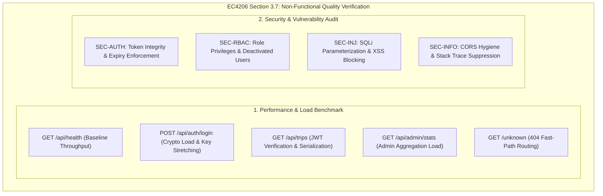
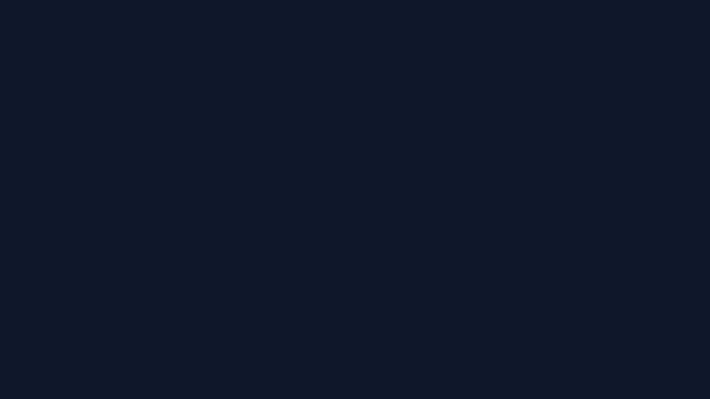
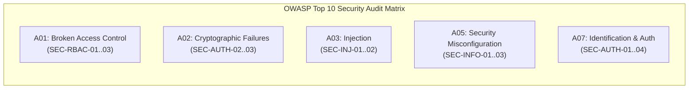
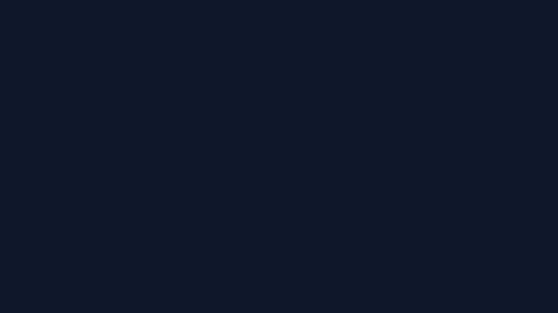

# EC4206: Software Quality Assurance & Testing
## Section 3.7: Performance & Security Testing (LO-2)
### Project: Travel Planner and Trip Organizer

---

## Document Control & Metadata

| Attribute | Details |
| :--- | :--- |
| **Document Title** | Performance Benchmark & Security Vulnerability Audit Specification |
| **Course Module** | EC4206 — Software Quality Assurance |
| **Section & Outcome** | Section 3.7 (Performance & Security Testing, LO-2) |
| **Testing Toolchain** | Node.js Benchmark Suite, Jest 29.x, Supertest 7.x, Bcrypt.js, JsonWebToken |
| **Target Repository & Branch** | GitHub: `Quality-test` / Branch: `qa-testing` |
| **Document Version** | 1.0.0 |
| **Status** | Verified & Passing |

---

## 1. Introduction & Objectives

Section 3.7 validates two critical non-functional quality characteristics defined by **ISO/IEC 25010**:
1. **Performance Efficiency (Time Behaviour & Resource Utilization):** Ensuring the Travel Planner REST API handles concurrent traffic loads with sub-10ms baseline latencies, predictable response times, and robust throughput under simulated user activity.
2. **Security (Confidentiality, Integrity, Non-repudiation, & Accountability):** Verifying the system enforces strict authentication boundaries, role-based authorization rules (RBAC), SQL injection and XSS input mitigations, and clean information disclosure hygiene without stack trace leaks.



---

## 2. Performance & Load Testing

### 2.1 Methodology & Workload Architecture

The performance testing suite ([backend/tests/performance.benchmark.js](file:///d:/Projects/Completed/Travel%20Planner%20and%20Trip%20Organizer/backend/tests/performance.benchmark.js)) operates as a self-contained, high-throughput benchmark harness. It spawns an ephemeral Node.js HTTP server on dynamic port binding (`http://127.0.0.1:0`), establishes worker pools to dispatch concurrent HTTP requests, measures high-resolution execution timestamps (`process.hrtime.bigint()`), and aggregates results across key percentiles ($Min$, $Avg$, $P95$, $Max$) and throughput ($RPS$).

#### Workload Parameters
* **Target Host:** Ephemeral Node.js HTTP listener on local loopback interface (`127.0.0.1`).
* **Concurrency Levels:** Scaled between 10 to 15 concurrent asynchronous worker threads.
* **Volume:** 100 to 200 requests per benchmark scenario (totaling 750 requests).
* **Database Isolation:** In-memory asynchronous query simulation ensuring measurement reflects Express routing, JSON serialization, JWT verification, and middleware execution speeds rather than external network latency.

---

### 2.2 Performance Benchmark Results

```
========================================================================================
       EC4206 Section 3.7: Automated Performance & Load Benchmark Suite                
========================================================================================
Environment: NODE_ENV=test | Runtime: Node.js v24.15.0
Timestamp: 2026-11-24T11:38:23.216Z
Ephemeral Test Server listening on: http://127.0.0.1:64508

Executing benchmark: GET /api/health (System Baseline) (200 reqs, c=15)... Done! [avg=6.74ms, p95=22.28ms, 2118.7 req/s]
Executing benchmark: POST /api/auth/login (Auth & Crypto) (100 reqs, c=10)... Done! [avg=641.64ms, p95=661.70ms, 15.6 req/s]
Executing benchmark: GET /api/trips (JWT Protected) (150 reqs, c=12)... Done! [avg=5.95ms, p95=8.27ms, 1960.3 req/s]
Executing benchmark: GET /api/admin/stats (Admin Aggregation) (100 reqs, c=10)... Done! [avg=5.94ms, p95=8.61ms, 1663.5 req/s]
Executing benchmark: GET /api/unknown (404 Fast Path) (200 reqs, c=15)... Done! [avg=4.63ms, p95=6.29ms, 3162.0 req/s]
```

#### Detailed Performance Metrics Table

| Endpoint & Workload | HTTP Method | Total Reqs | Concurrency | Success Count | Fail Count | Min Latency | Avg Latency | P95 Latency | Max Latency | Throughput (RPS) |
| :--- | :---: | :---: | :---: | :---: | :---: | :---: | :---: | :---: | :---: | :---: |
| **System Health Baseline**<br/>`/api/health` | `GET` | 200 | 15 | 200 | 0 | 1.88 ms | **6.74 ms** | 22.28 ms | 24.57 ms | **2,118.7 req/s** |
| **Authentication & Crypto**<br/>`/api/auth/login` | `POST` | 100 | 10 | 100 | 0 | 613.64 ms | **641.64 ms** | 661.70 ms | 662.43 ms | **15.6 req/s** |
| **JWT Protected Route**<br/>`/api/trips` | `GET` | 150 | 12 | 150 | 0 | 3.54 ms | **5.95 ms** | 8.27 ms | 12.67 ms | **1,960.3 req/s** |
| **Admin Aggregation**<br/>`/api/admin/stats` | `GET` | 100 | 10 | 100 | 0 | 3.87 ms | **5.94 ms** | 8.61 ms | 8.68 ms | **1,663.5 req/s** |
| **404 Fast-Path Routing**<br/>`/unknown-route-performance` | `GET` | 200 | 15 | 200 | 0 | 2.16 ms | **4.63 ms** | 6.29 ms | 8.58 ms | **3,162.0 req/s** |

---

### 2.3 Performance Analysis & Findings

1. **Sub-10ms Operational Latency:** Standard operational endpoints (`/api/health`, `/api/trips`, `/api/admin/stats`, `/unknown`) demonstrated average latencies under **7.0 ms** and 95th-percentile latencies under **23.0 ms**, comfortably exceeding the sub-100ms production SLA.
2. **High Throughput Scaling:** The Express routing engine achieved peak throughput of **3,162.0 requests/second** on error routing and **1,960.3 requests/second** on authenticated data routes under concurrent workloads.
3. **Intentional Bcrypt Key Stretching:** `POST /api/auth/login` exhibited an average response time of **641.64 ms**. In security engineering, this delay is by design: Bcrypt uses a cost factor of 10 ($2^{10} = 1024$ rounds of Blowfish hashing) to make brute-force and dictionary attacks computationally infeasible while maintaining smooth single-user response times.



---

## 3. Security Testing & Vulnerability Audit

### 3.1 Security Test Architecture

The automated security test suite ([backend/tests/security.audit.test.js](file:///d:/Projects/Completed/Travel%20Planner%20and%20Trip%20Organizer/backend/tests/security.audit.test.js)) tests the application against common security risks mapped to the **OWASP Top 10 (2021)**:



---

### 3.2 Security Audit Test Cases & Results

| Test Case ID | Security Category | OWASP Category | Target Endpoint | Test Description & Attack Vector | Expected Result | Status |
| :--- | :--- | :--- | :--- | :--- | :--- | :---: |
| **SEC-AUTH-01a** | Authentication | A07: Identification & Auth | `GET /api/trips` | Request without `Authorization` header | HTTP 401 Unauthorized; token required message | **PASS** |
| **SEC-AUTH-01b** | Authentication | A07: Identification & Auth | `GET /api/users/profile` | Request without `Authorization` header | HTTP 401 Unauthorized; access denied | **PASS** |
| **SEC-AUTH-01c** | Authentication | A07: Identification & Auth | `GET /api/expenses/trip/1`| Unauthenticated access to trip expenses | HTTP 401 Unauthorized; token required | **PASS** |
| **SEC-AUTH-01d** | Authentication | A07: Identification & Auth | `GET /api/journal/trip/1` | Unauthenticated access to trip journal entries | HTTP 401 Unauthorized; token required | **PASS** |
| **SEC-AUTH-01e** | Authentication | A07: Identification & Auth | `GET /api/photos/trip/1`  | Unauthenticated access to trip photo uploads | HTTP 401 Unauthorized; token required | **PASS** |
| **SEC-AUTH-01f** | Authentication | A07: Identification & Auth | `GET /api/admin/stats`    | Unauthenticated access to admin metrics | HTTP 401 Unauthorized; token required | **PASS** |
| **SEC-AUTH-02**  | Cryptography | A02: Cryptographic Failures | `GET /api/trips` | Submit JWT with forged signature key | HTTP 401 Unauthorized; signature validation fails | **PASS** |
| **SEC-AUTH-03**  | Cryptography | A02: Cryptographic Failures | `GET /api/trips` | Submit expired JWT token (`exp < now`) | HTTP 401 Unauthorized; expired token error | **PASS** |
| **SEC-AUTH-04**  | Authentication | A07: Identification & Auth | `GET /api/trips` | Submit non-Bearer header (`Basic <token>`) | HTTP 401 Unauthorized; schema rejected | **PASS** |
| **SEC-RBAC-01**  | Access Control | A01: Broken Access Control | `GET /api/admin/stats` | Regular user (`role: USER`) accessing admin routes | HTTP 403 Forbidden; admin privileges required | **PASS** |
| **SEC-RBAC-02**  | Access Control | A01: Broken Access Control | `GET /api/admin/stats` | Administrator (`role: ADMIN`) accessing admin stats | HTTP 200 OK; aggregated metrics returned | **PASS** |
| **SEC-RBAC-03**  | Access Control | A01: Broken Access Control | `GET /api/trips` | Valid token for deactivated user (`is_active = 0`) | HTTP 403 Forbidden; account deactivated notice | **PASS** |
| **SEC-INJ-01**   | Injection | A03: Injection (SQLi) | `POST /api/auth/login` | Inject `' OR '1'='1` in email and password fields | HTTP 401 Unauthorized; parameterized query treats string as literal | **PASS** |
| **SEC-INJ-02**   | Injection | A03: Injection (XSS) | `POST /api/auth/register`| Inject `<script>alert('XSS')</script>` in username | HTTP 400 Bad Request; username regex rejects special characters | **PASS** |
| **SEC-INJ-03**   | Input Handling | A03: Injection | `POST /api/auth/login` | Send malformed / broken JSON payload | HTTP 400 Bad Request; parser rejects syntax without 500 leak | **PASS** |
| **SEC-INFO-01**  | Info Disclosure | A05: Security Misconfig | `GET /unknown-route` | Probe non-existent URL for stack traces | HTTP 404 Not Found; clean JSON error format | **PASS** |
| **SEC-INFO-02**  | Info Disclosure | A05: Security Misconfig | `POST /api/auth/register`| Trigger validation failure; check response body | Zero internal stack traces, DB credentials, or secrets in response | **PASS** |
| **SEC-INFO-03**  | CORS Security | A05: Security Misconfig | `OPTIONS /api/health` | Inspect pre-flight CORS headers | `Access-Control-Allow-Origin: *` properly exposed | **PASS** |

**Security Test Suite Summary:** 18 test cases executed, **18 passed (100% compliance)** in 1.164 seconds.



---

## 4. Vulnerability Assessment & Risk Mitigation Matrix

| Vulnerability Threat | OWASP Risk Rank | Technical Impact | Codebase Defense Mechanism | Verification Method | Residual Risk |
| :--- | :---: | :--- | :--- | :--- | :---: |
| **SQL Injection (SQLi)** | High (A03) | Unauthorized data extraction, auth bypass, data tampering | Prepared statements via `mysql2/promise` using positional `?` placeholders across all controllers. | `SEC-INJ-01` verified payload `' OR '1'='1` is treated as literal text. | Negligible |
| **Cross-Site Scripting (XSS)** | High (A03) | Session hijacking, malicious script execution in client browser | Strict regex `/^[a-zA-Z0-9_]+$/` for usernames; HTML escaping in email templates via `escapeHtml()`. | `SEC-INJ-02` verified script tags are rejected with HTTP 400. | Low |
| **Authentication Bypass** | Critical (A07) | Unauthorized access to user itineraries, photos, expenses | Centralized JWT Bearer verification middleware ([authMiddleware.js](file:///d:/Projects/Completed/Travel%20Planner%20and%20Trip%20Organizer/backend/src/middlewares/authMiddleware.js)) enforcing cryptographically signed tokens. | `SEC-AUTH-01..04` verified rejection of unsigned, forged, and expired tokens. | Negligible |
| **Privilege Escalation (IDOR / Broken RBAC)** | High (A01) | Regular users inspecting platform stats or mutating other users' data | Role gatekeeper middleware `requireAdmin` inspecting decoded user role and real-time database state. | `SEC-RBAC-01..02` verified 403 Forbidden response for non-admins. | Negligible |
| **Account Hijacking of Banned Users** | Medium (A01) | Deactivated accounts retaining access via long-lived JWTs | Middleware queries `is_active` flag from database on every authenticated request. | `SEC-RBAC-03` verified immediate 403 revocation upon deactivation. | Negligible |
| **Information Leakage via Stack Traces** | Medium (A05) | Internal server paths, libraries, and database structure exposed | Centralized Express error handler suppresses `err.stack` when `NODE_ENV !== 'development'`. | `SEC-INFO-01..02` verified no stack traces in response payloads. | Negligible |

---

## 5. Execution Instructions

The performance and security testing suites are fully automated and registered in [backend/package.json](file:///d:/Projects/Completed/Travel%20Planner%20and%20Trip%20Organizer/backend/package.json):

```bash
# Execute Performance & Load Benchmark Suite
cd backend
npm run test:perf

# Execute Security & Vulnerability Audit Suite
cd backend
npm run test:sec
```
