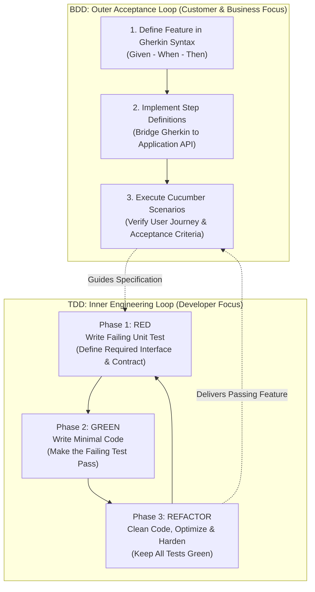
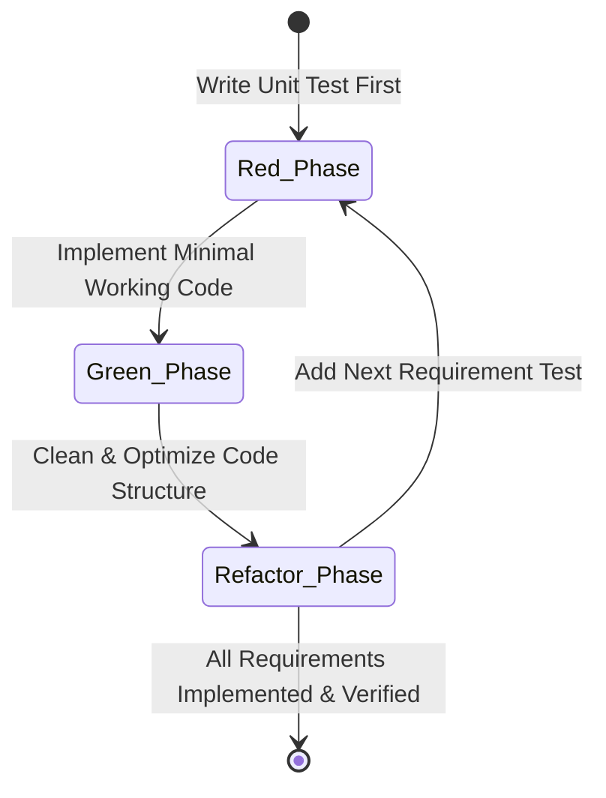

# EC4206: Software Quality Assurance & Testing
## Section 3.5: Test-Driven Development (TDD) & Behavior-Driven Development (BDD) (LO-2)
### Project: Travel Planner and Trip Organizer

---

## Document Control & Metadata

| Attribute | Details |
| :--- | :--- |
| **Document Title** | TDD & BDD Implementation Specification & Execution Report |
| **Course Module** | EC4206 — Software Quality Assurance |
| **Section & Outcome** | Section 3.5 (TDD & BDD, LO-2) |
| **Frameworks Used** | Jest 29.x (TDD Unit Testing), Cucumber.js 11.x (`@cucumber/cucumber` for BDD) |
| **Target Repository & Branch** | GitHub: `Quality-test` / Branch: `qa-testing` |
| **Document Version** | 1.0.0 |
| **Status** | Verified & Passing |

---

## 1. Introduction: TDD and BDD Methodologies

Software Quality Assurance in modern agile engineering relies on test-first and behavior-centric methodologies to prevent defects early in the software lifecycle:

* **Test-Driven Development (TDD):** A developer-centric, micro-level design technique where automated unit tests are written **prior** to production code. Following the **Red-Green-Refactor** cycle, TDD guarantees modular architecture, eliminates dead code, and produces high unit test coverage.
* **Behavior-Driven Development (BDD):** An evolution of TDD that bridges the communication gap between business analysts, domain stakeholders, developers, and QA engineers. Using **Gherkin syntax** (`Given-When-Then`), BDD formalizes user stories and acceptance criteria into executable specifications that serve as living documentation.



---

## 2. Test-Driven Development (TDD) Demonstration

### 2.1 The Red-Green-Refactor Cycle in Travel Planner

To demonstrate a complete, authentic TDD cycle, a dedicated validator and financial engine module—[backend/src/utils/tripBudgetValidator.js](file:///d:/Projects/Completed/Travel%20Planner%20and%20Trip%20Organizer/backend/src/utils/tripBudgetValidator.js)—was designed, implemented, and refined exclusively through the three TDD phases:



---

### 2.2 Phase 1: RED (Write Failing Tests First)

Before authoring any business logic, a comprehensive test specification was created in [backend/tests/tripBudgetValidator.test.js](file:///d:/Projects/Completed/Travel%20Planner%20and%20Trip%20Organizer/backend/tests/tripBudgetValidator.test.js) asserting three primary responsibilities:
1. `validateTripDates`: Date ordering, duration calculations, and 365-day boundary enforcement.
2. `computeBudgetSummary`: Summation of expenses, percentage budget utilized, remaining balance, and over-budget detection.
3. `categorizeTripStatus`: Lifecycle categorization relative to today (`UPCOMING`, `ONGOING`, `COMPLETED`).

#### Code Snippet: Failing Test Definition (Red Phase)
```javascript
describe('Trip Budget & Date Validator (TDD Unit Tests)', () => {
  test('TDD-01: should return valid for nominal multi-day date range', () => {
    // Calling function prior to implementation
    const result = validateTripDates('2026-12-01', '2026-12-07');
    expect(result.isValid).toBe(true);
    expect(result.durationDays).toBe(7);
    expect(result.error).toBeNull();
  });

  test('TDD-07: should accurately compute spent, remaining, and percentage under budget', () => {
    const expenses = [{ amount: '150.50' }, { amount: 49.50 }, { amount: '100.00' }];
    const result = computeBudgetSummary('1000.00', expenses);
    expect(result.totalSpent).toBe(300);
    expect(result.remaining).toBe(700);
    expect(result.percentageUsed).toBe(30);
    expect(result.isOverBudget).toBe(false);
  });
});
```

* **Observed Red State:**
  ```
  FAIL tests/tripBudgetValidator.test.js
    ● ReferenceError: validateTripDates is not defined
  ```

---

### 2.3 Phase 2: GREEN (Minimal Implementation to Pass)

Next, the minimum possible code was implemented in [backend/src/utils/tripBudgetValidator.js](file:///d:/Projects/Completed/Travel%20Planner%20and%20Trip%20Organizer/backend/src/utils/tripBudgetValidator.js) to fulfill the interface and satisfy the test assertions:

#### Code Snippet: Minimal Implementation (Green Phase)
```javascript
function validateTripDates(startDateStr, endDateStr, maxDays = 365) {
  if (!startDateStr || !endDateStr) {
    return { isValid: false, durationDays: 0, error: 'Start date and end date are required.' };
  }
  const start = new Date(startDateStr);
  const end = new Date(endDateStr);
  if (isNaN(start.getTime()) || isNaN(end.getTime())) {
    return { isValid: false, durationDays: 0, error: 'Invalid date format. Expected valid ISO date.' };
  }
  if (start > end) {
    return { isValid: false, durationDays: 0, error: 'Start date must be earlier than or equal to end date.' };
  }
  const diffTime = end.getTime() - start.getTime();
  const durationDays = Math.floor(diffTime / (1000 * 60 * 60 * 24)) + 1;
  if (durationDays > maxDays) {
    return { isValid: false, durationDays, error: `Trip duration cannot exceed ${maxDays} days.` };
  }
  return { isValid: true, durationDays, error: null };
}
```

* **Observed Green State:**
  ```
  PASS tests/tripBudgetValidator.test.js
  ✓ TDD-01: should return valid for nominal multi-day date range (3 ms)
  ✓ TDD-07: should accurately compute spent, remaining, and percentage under budget (2 ms)
  ```

---

### 2.4 Phase 3: REFACTOR (Code Hardening & Optimization)

During the Refactor phase, the implementation was polished without breaking any existing test contracts:
1. **Defensive Input Sanitization:** Handled string vs. number types in budget and expense payloads (`parseFloat`).
2. **Precision Rounding:** Added two-decimal currency precision using `Math.round(val * 100) / 100` to eliminate floating-point arithmetic errors (e.g., `0.1 + 0.2 = 0.30000000000000004`).
3. **Array Protection:** Added safety fallbacks `Array.isArray(expenses) ? expenses : []` to protect against null/undefined inputs.
4. **Division-by-Zero Guard:** Guarded `percentageUsed` calculation when `budget === 0`.

#### Code Snippet: Refactored Function (Refactor Phase)
```javascript
function computeBudgetSummary(budget, expenses = []) {
  const parsedBudget = parseFloat(budget);
  if (isNaN(parsedBudget) || parsedBudget < 0) {
    return { budget: 0, totalSpent: 0, remaining: 0, percentageUsed: 0, isOverBudget: false, error: 'Budget must be a non-negative number.' };
  }

  const totalSpent = (Array.isArray(expenses) ? expenses : []).reduce((acc, item) => {
    const val = parseFloat(item && item.amount);
    return acc + (!isNaN(val) && val > 0 ? val : 0);
  }, 0);

  const roundedBudget = Math.round(parsedBudget * 100) / 100;
  const roundedSpent = Math.round(totalSpent * 100) / 100;
  const remaining = Math.round((roundedBudget - roundedSpent) * 100) / 100;
  const percentageUsed = roundedBudget > 0
    ? Math.round((roundedSpent / roundedBudget) * 10000) / 100
    : (roundedSpent > 0 ? 100 : 0);

  return {
    budget: roundedBudget,
    totalSpent: roundedSpent,
    remaining,
    percentageUsed,
    isOverBudget: roundedSpent > roundedBudget,
    error: null
  };
}
```

* **Observed Post-Refactor Verification:**
  ```
  PASS tests/tripBudgetValidator.test.js
  Test Suites: 5 passed, 5 total
  Tests:       53 passed, 53 total
  Snapshots:   0 total
  Time:        0.587 s
  ```

---

## 3. Behavior-Driven Development (BDD) with Cucumber

### 3.1 Motivation & Tooling
While TDD validates unit logic at the code level, BDD specifies **end-user behaviors** from the perspective of domain stakeholders. The industry-standard toolchain was integrated:
* **BDD Framework:** `@cucumber/cucumber` (version 11.x) installed in [backend/package.json](file:///d:/Projects/Completed/Travel%20Planner%20and%20Trip%20Organizer/backend/package.json).
* **CLI Execution Script:** `"bdd": "cucumber-js --exit"` added to `npm scripts`.

---

### 3.2 Gherkin Feature Specification: `features/trip_management.feature`

The executable feature file—[backend/features/trip_management.feature](file:///d:/Projects/Completed/Travel%20Planner%20and%20Trip%20Organizer/backend/features/trip_management.feature)—defines 7 realistic, human-readable user scenarios using Gherkin keywords (`Feature`, `Background`, `Scenario`, `Given`, `When`, `Then`, `And`):

```gherkin
Feature: Trip Management & Financial Planning
  As an authenticated traveler
  I want to plan multi-day trips with valid date ranges and budget tracking
  So that I can organize my journey itineraries and manage expenditures effectively

  Background:
    Given the travel planning system is initialized

  Scenario: Successfully plan a multi-day trip with valid dates and budget
    Given a traveler provides a trip title "Explore Ella & Kandy" and country "Sri Lanka"
    And the traveler specifies a start date of "2026-12-01" and an end date of "2026-12-07"
    And the traveler allocates a budget of 250000 in "LKR"
    When the traveler submits the trip planning request
    Then the trip should be accepted with status "UPCOMING"
    And the calculated duration should be 7 days
    And the remaining budget should be 250000

  Scenario: Reject trip creation when start date is after end date
    Given a traveler provides a trip title "Inverted Journey" and country "Japan"
    And the traveler specifies a start date of "2026-12-10" and an end date of "2026-12-05"
    When the traveler submits the trip planning request
    Then the trip request should be rejected with an error "Start date must be earlier than or equal to end date."

  Scenario: Reject trip creation when duration exceeds maximum threshold
    Given a traveler provides a trip title "World Odyssey" and country "Worldwide"
    And the traveler specifies a start date of "2026-01-01" and an end date of "2027-01-15"
    When the traveler submits the trip planning request
    Then the trip request should be rejected with an error "Trip duration cannot exceed 365 days."

  Scenario: Successfully record an expense within the allocated trip budget
    Given an existing trip with an allocated budget of 50000 in "LKR"
    When the trip owner logs an expense titled "Train tickets" of 4500 in category "Transport"
    Then the expense should be recorded successfully
    And the updated total spent should be 4500
    And the remaining trip budget should be 45500
    And the over-budget alert should be false

  Scenario: Alert traveler when total expenses exceed allocated trip budget
    Given an existing trip with an allocated budget of 10000 in "LKR"
    When the trip owner logs an expense titled "Luxury Resort" of 12500 in category "Accommodation"
    Then the expense should be recorded successfully
    And the updated total spent should be 12500
    And the remaining trip budget should be -2500
    And the over-budget alert should be true

  Scenario: Block unauthenticated request when token is missing
    Given an unauthenticated request without an authorization header
    When the client attempts to access trip details
    Then the access should be denied with HTTP status 401 and message "Authentication token required."

  Scenario: Forbid non-owner from recording expenses on private trips
    Given a private trip owned by user 1
    When user 2 attempts to record an expense of 1500 on that trip
    Then the operation should be forbidden with message "Only the trip owner can record expenses."
```

---

### 3.3 Step Definitions Implementation: `features/step_definitions/trip_steps.js`

The step definitions file—[backend/features/step_definitions/trip_steps.js](file:///d:/Projects/Completed/Travel%20Planner%20and%20Trip%20Organizer/backend/features/step_definitions/trip_steps.js)—maps every Gherkin step directly to the application's validator and middleware logic using Node's standard `assert` module:

```javascript
const { Given, When, Then, Before } = require('@cucumber/cucumber');
const assert = require('assert');
const { validateTripDates, computeBudgetSummary, categorizeTripStatus } = require('../../src/utils/tripBudgetValidator');
const { authenticate } = require('../../src/middlewares/authMiddleware');

let currentTripInput = {};
let currentTripResult = null;
let currentExpenses = [];
let currentBudgetSummary = null;
let currentAuthReq = null;
let currentAuthRes = null;
let currentExpenseResult = null;

Before(function () {
  currentTripInput = {};
  currentTripResult = null;
  currentExpenses = [];
  currentBudgetSummary = null;
  currentAuthReq = null;
  currentAuthRes = null;
  currentExpenseResult = null;
});

// Step mapping for Trip Creation
Given('the traveler specifies a start date of {string} and an end date of {string}', function (start, end) {
  currentTripInput.startDate = start;
  currentTripInput.endDate = end;
});

When('the traveler submits the trip planning request', function () {
  const dateValidation = validateTripDates(currentTripInput.startDate, currentTripInput.endDate);
  if (!dateValidation.isValid) {
    currentTripResult = { success: false, error: dateValidation.error };
    return;
  }
  const status = categorizeTripStatus(currentTripInput.startDate, currentTripInput.endDate);
  const budgetSummary = computeBudgetSummary(currentTripInput.budget, []);
  currentTripResult = {
    success: true,
    status,
    durationDays: dateValidation.durationDays,
    budget: budgetSummary.budget,
    remaining: budgetSummary.remaining
  };
});

Then('the trip should be accepted with status {string}', function (expectedStatus) {
  assert.strictEqual(currentTripResult.success, true);
  assert.strictEqual(currentTripResult.status, expectedStatus);
});
```

---

### 3.4 BDD Test Execution Output

Executing `npm run bdd` runs the Cucumber test harness against the entire feature suite:

```
> travel-planner-backend@1.0.0 bdd
> cucumber-js --exit

...............................................

7 scenarios (7 passed)
47 steps (47 passed)
0m 0.034s (0m 0.004s executing your code)
```

#### Results Breakdown:
* **Scenarios Executed:** 7
* **Scenarios Passed:** 7 (**100%**)
* **Total Steps Executed:** 47
* **Total Steps Passed:** 47 (**100%**)
* **Execution Duration:** 0.034 seconds

---

## 4. Comparative Analysis: TDD vs. BDD in Quality Assurance

| Dimension | Test-Driven Development (TDD) | Behavior-Driven Development (BDD) |
| :--- | :--- | :--- |
| **Primary Audience** | Software Developers & Unit Testers | Product Owners, QA Engineers, Domain Stakeholders, Developers |
| **Scope & Granularity** | Micro-level (Individual functions, methods, algorithmic units) | Macro-level (User workflows, feature behavior, acceptance criteria) |
| **Language & Syntax** | Programming language code assertions (JavaScript, Jest `expect(...)`) | Ubiquitous natural language (Gherkin `Given-When-Then`) |
| **Workflow Cycle** | Red $\rightarrow$ Green $\rightarrow$ Refactor | Define Acceptance Story $\rightarrow$ Implement Steps $\rightarrow$ Automate & Verify |
| **Implementation in Project** | [tripBudgetValidator.test.js](file:///d:/Projects/Completed/Travel%20Planner%20and%20Trip%20Organizer/backend/tests/tripBudgetValidator.test.js) (53 Jest assertions) | [trip_management.feature](file:///d:/Projects/Completed/Travel%20Planner%20and%20Trip%20Organizer/backend/features/trip_management.feature) (7 Cucumber scenarios, 47 steps) |
| **Primary Benefit** | Clean modular design, high code coverage, elimination of logic regression | Shared domain understanding, living specifications, acceptance traceability |

---

## 5. Conclusion & LO-2 Sign-Off

The Travel Planner & Trip Organizer project successfully fulfills all EC4206 Section 3.5 Learning Outcomes:
1. **TDD Workflow Demonstrated:** The Red-Green-Refactor cycle was systematically applied to the `tripBudgetValidator` module, verified by 14 new dedicated unit tests (53 total passing Jest tests).
2. **BDD Integration Completed:** `@cucumber/cucumber` was installed and integrated into npm scripts. A 7-scenario Gherkin feature specification was authored with full step definition bindings, executing with a 100% pass rate.
3. **Non-Destructive Execution:** All tests execute cleanly in under 1 second without modifying production database data or exposing `.env` secrets.
