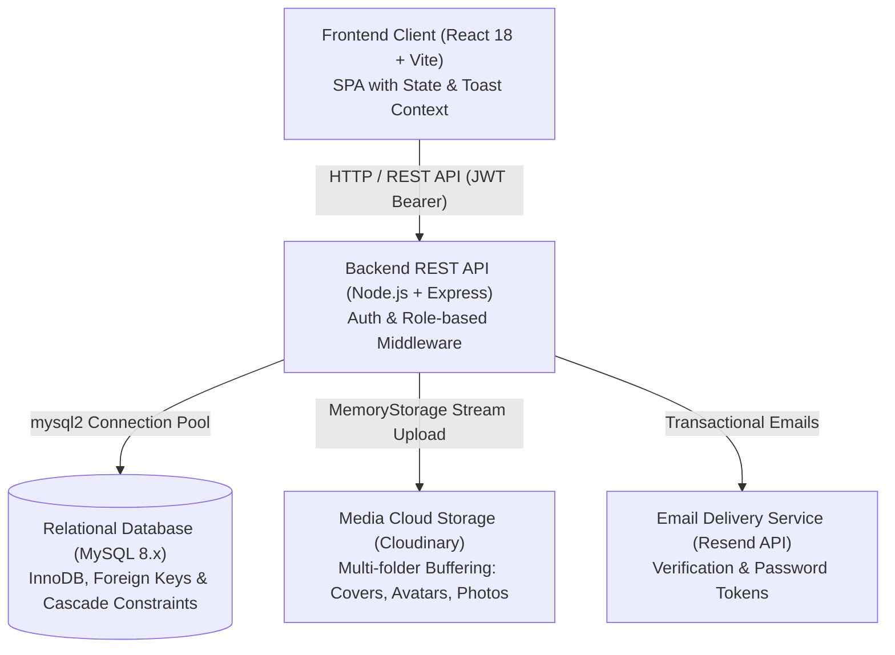
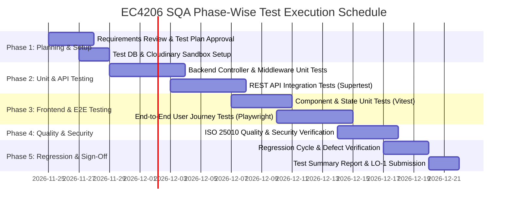
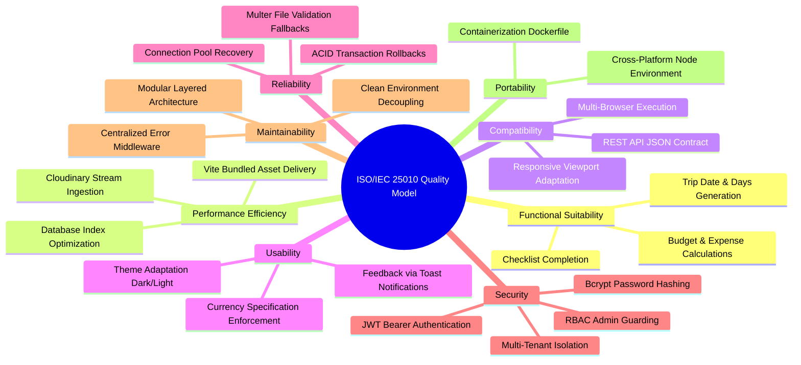
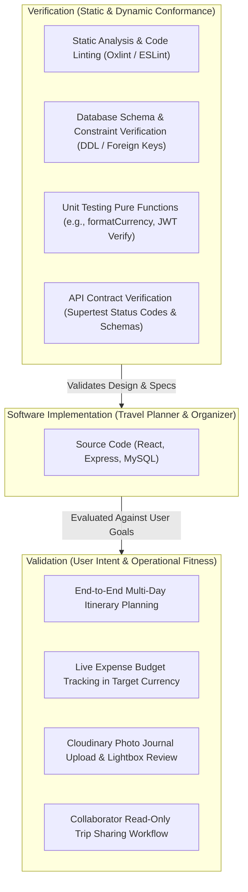

# EC4206: Software Quality Assurance & Testing
## Section 3.1: Introduction & Test Planning (LO-1)
### Project: Travel Planner and Trip Organizer

---

## Document Control & Metadata

| Attribute | Details |
| :--- | :--- |
| **Document Title** | Software Test Plan (STP) — Introduction & Test Planning |
| **Course Module** | EC4206 — Software Quality Assurance |
| **Section & Outcome** | Section 3.1 (Introduction & Test Planning, LO-1) |
| **System Under Test (SUT)**| Travel Planner & Live Travel Journal Web Application |
| **Repository & Branch** | GitHub: `Quality-test` repository / Branch: `qa-testing` |
| **Architecture** | Client-Server (SPA React/Vite + REST API Node.js/Express + MySQL 8.x + Cloudinary CDN) |
| **Document Version** | 1.0.0 |
| **Status** | Approved for Execution |

---

## 1. System Overview & Context

**Travel Planner and Trip Organizer** is a full-stack, responsive web application designed to help individual travelers and groups plan multi-day trips, track daily itineraries and destinations, manage real-time categorized travel expenses against predefined budgets in multiple currencies (e.g., LKR, USD, EUR, GBP), document live journal entries, upload photo memories to Cloudinary, and share trips collaboratively with read-only peer access. The platform also provides an administrative dashboard for user monitoring, system statistics, and broadcast messaging.

---

## 2. Test Scope (In-Scope & Out-of-Scope)

### 2.1 In-Scope Features, Modules, Endpoints & UI Flows

The test scope encompasses all functional components, REST API endpoints, database operations, third-party integrations, and user interface workflows built into the codebase:

#### Module 1: Authentication, Authorization & User Management
* **Endpoints:**
  * `POST /api/auth/register` — New user registration with automatic verification and welcome system notification.
  * `GET /api/auth/verify-email` — Token-based email verification handling.
  * `POST /api/auth/resend-verification` — Regreshed token delivery for unverified accounts.
  * `POST /api/auth/login` — Credential validation (username/email + bcrypt password match), active status check, and JWT issuance.
  * `GET /api/auth/me` — Authenticated session verification.
  * `POST /api/auth/forgot-password` & `POST /api/auth/reset-password` — Token-based self-service password recovery.
  * `GET /api/users/profile` & `PUT /api/users/profile` — Profile retrieval and name/username modification.
  * `POST /api/users/avatar` — Profile avatar image upload via Multer buffer stream to Cloudinary (`travel-planner/avatars`).
  * `PUT /api/users/change-password` — Current password verification and hash update.
  * `GET /api/users/search` — Querying users by username or email for collaboration.
* **UI Flows:**
  * Authentication page (`AuthPage.jsx`) tab toggling between Login, Registration, Forgot Password, and Reset Password.
  * Profile page (`ProfilePage.jsx`) form updates, live avatar upload, and password change modal.
  * Global route guards in `App.jsx` checking `isAuthenticated` and token expiration.

#### Module 2: Trip Planning & Day Generation
* **Endpoints:**
  * `GET /api/trips` — Listing all owned and shared trips with aggregated metadata.
  * `GET /api/trips/:id` — Deep fetch of complete trip tree: metadata, days, destinations, checklist items, expenses, photos, journals, and collaborators.
  * `POST /api/trips` — Multipart form trip creation with cover image upload to Cloudinary (`travel-planner/covers`) and automated sequential `trip_days` generation based on `start_date` and `end_date`.
  * `PUT /api/trips/:id` — Trip details and cover image modification.
  * `DELETE /api/trips/:id` — Cascade deletion of trip and all associated child entities.
* **UI Flows:**
  * `CreateTripModal.jsx` modal input: date span validation, currency selection (USD, LKR, EUR, GBP, JPY, SGD, INR, AUD, CAD), budget input, and cover photo upload.
  * `MyTrips.jsx` dashboard: filtering by status (`ALL`, `UPCOMING`, `ONGOING`, `COMPLETED`), search filtering by destination country and title.
  * `TripDetailPage.jsx` header overview: countdown calculation, budget consumption progress bar, and status badge updates.

#### Module 3: Daily Journey Itinerary & Destination Exploration
* **Endpoints:**
  * `PUT /api/days/:id` — Updating day title, notes, and progress status.
  * `POST /api/days/:dayId/destinations` — Adding timed destinations with estimated costs and sequence order.
  * `PUT /api/destinations/:id` — Updating destination parameters and actual expenditure.
  * `POST /api/destinations/:id/complete` — Toggling destination completion status.
  * `DELETE /api/destinations/:id` — Removing a destination and linked sub-items.
  * `POST /api/destinations/:destId/exploration` — Adding exploration checklist items.
  * `PUT /api/exploration/:id/toggle` — Toggling checklist completion flag (`is_completed`).
  * `DELETE /api/exploration/:id` — Removing checklist items.
* **UI Flows:**
  * Itinerary Timeline (`activeTab === 'journey'` in `TripDetailPage.jsx`): expanding/collapsing days, adding destinations, checking off exploration activities, reordering items, and viewing destination cards.

#### Module 4: Expense Tracking & Multi-Currency Budgeting
* **Endpoints:**
  * `GET /api/expenses/trip/:tripId` — Aggregated expense report with category breakdown.
  * `POST /api/expenses/trip/:tripId` — Logging expenses categorized under `Food`, `Transport`, `Entrance Fees`, `Shopping`, `Accommodation`, or `Other`, optionally linked to specific days or destinations.
  * `PUT /api/expenses/:id` — Expense update.
  * `DELETE /api/expenses/:id` — Expense deletion.
* **UI Flows:**
  * Expenses Tab (`activeTab === 'expenses'` in `TripDetailPage.jsx`): Category expense distribution, budget utilization percentage, remaining balance calculation, and currency formatting compliance (e.g., `Rs. 300,000` for LKR).

#### Module 5: Live Travel Journal
* **Endpoints:**
  * `GET /api/journal/trip/:tripId` — Retrieval of historical journal entries.
  * `POST /api/journal/trip/:tripId` — Composing journal notes with markdown/text content, date stamping, and optional destination linking.
  * `PUT /api/journal/:id` — Modifying journal entries.
  * `DELETE /api/journal/:id` — Removing journal entries.
* **UI Flows:**
  * Journal Tab (`activeTab === 'journal'`): chronological diary feed, entry authoring modal, and day-to-entry cross-referencing.

#### Module 6: Photo Memories & Gallery Management
* **Endpoints:**
  * `GET /api/photos/memories` — Global gallery retrieval across all trips for the authenticated user.
  * `GET /api/photos/trip/:tripId` — Photo collection for a single trip.
  * `POST /api/photos/trip/:tripId` — Batch upload (up to 10 images) via Multer buffer to Cloudinary (`travel-planner/photos`).
  * `PUT /api/photos/:id/favorite` — Toggling favorite status (`is_favorite`).
  * `DELETE /api/photos/:id` — Photo record removal.
* **UI Flows:**
  * Single trip Memories tab and global `MemoriesGallery.jsx`: photo grid, favorite filtering, image preview lightbox, and batch upload dialog.

#### Module 7: Collaboration & Trip Sharing
* **Endpoints:**
  * `GET /api/sharing/shared-with-me` — Trips shared with the current user.
  * `GET /api/sharing/trip/:tripId/collaborators` — Listing active collaborators for an owned trip.
  * `POST /api/sharing/trip/:tripId/share` — Granting `VIEWER` permission to another user by email/username and dispatching an in-app notification.
  * `DELETE /api/sharing/trip/:tripId/share/:targetUserId` — Revoking collaboration access.
* **UI Flows:**
  * `SharedWithMe.jsx` page: browsing read-only itineraries.
  * Share Tab in `TripDetailPage.jsx`: searching users, inviting collaborators, and revoking rights.
  * Enforcing read-only permission constraints in UI (hiding Edit/Delete buttons for non-owners).

#### Module 8: Notifications & Administrative Control
* **Endpoints:**
  * `GET /api/notifications` — Fetching unread and read user notifications.
  * `PUT /api/notifications/:id/read` & `PUT /api/notifications/read-all` — Read status tracking.
  * `GET /api/admin/stats` — High-level platform statistics (total users, trips, destinations, expenses).
  * `GET /api/admin/users` — User directory with active status toggles.
  * `PUT /api/admin/users/:id/status` — Account suspension/activation.
  * `GET /api/admin/messages` & `POST /api/admin/messages` — System-wide broadcast and direct administrative messaging.
* **UI Flows:**
  * `Navbar.jsx` interactive notifications bell popover with unread badges.
  * `AdminDashboard.jsx`: restricted admin analytics, user toggle switches, and announcement creator.

---

### 2.2 Out-of-Scope Items

The following aspects are explicitly excluded from this testing phase:
1. **Third-Party Payment Gateways:** Real-world monetary transactions, credit card processing, payment gateways (Stripe, PayPal, Razorpay), and banking compliance (PCI-DSS), as the system strictly tracks estimated and logged expenses without financial settlement.
2. **External Live Travel Booking Engines:** Live GDS/OTA APIs (e.g., Amadeus, Skyscanner, Expedia, Booking.com) for real-time flight ticket or hotel room reservations.
3. **Turn-by-Turn GPS Navigation & Geofencing:** Real-time satellite GPS tracking, live vehicular routing, or hardware-assisted background location tracking.
4. **Native Mobile OS Testing:** Native iOS (Swift) or Android (Kotlin) binary builds and mobile app store distribution testing (only responsive mobile web in modern browsers is in scope).
5. **Third-Party Infrastructure SLAs:** Internal availability, outage handling, and hardware SLA testing of external cloud SaaS platforms (Cloudinary servers, Resend mail delivery relay clusters).
6. **Multi-Region Database Sharding:** Multi-master database cluster failover and distributed partition testing, as the database operates on a single primary MySQL 8.x instance.

---

## 3. Short Test Plan

### 3.1 Test Objectives
1. **Functional Integrity:** Validate that every REST endpoint correctly handles valid inputs, invalid payloads, edge cases, and returns standardized JSON contracts with proper HTTP status codes.
2. **Security & Data Isolation:** Ensure strict authentication via JWT, robust password hashing with `bcryptjs`, role-based access control (RBAC) preventing unauthorized privilege escalation to `/api/admin`, and multi-tenant data isolation preventing unauthorized access to other users' trips.
3. **Database Consistency & ACID Transactions:** Verify MySQL relational constraints, foreign keys, cascade deletions, and transaction rollbacks during multi-step operations (e.g., trip creation, user registration).
4. **Media Handling Reliability:** Validate Multer memory buffer ingestion, file format filtering (`.jpg`, `.jpeg`, `.png`, `.webp`, `.gif`), file size limit enforcement (10 MB), and Cloudinary stream upload resolution.
5. **Frontend State & UI Responsiveness:** Verify that React state managers (`AuthContext`, `ThemeContext`, `ToastContext`) update deterministically without memory leaks, render across mobile and desktop breakpoints, and format currencies correctly.

### 3.2 Scope Summary
The test execution covers automated unit tests, backend REST API integration tests, database schema validation, frontend component testing, and end-to-end (E2E) workflow testing spanning all 8 core application modules.

### 3.3 Test Resources & Environment Setup

| Resource Category | Specification & Configuration | Purpose |
| :--- | :--- | :--- |
| **Frontend Framework** | React 18.x, Vite, React Lucide Icons, Pure CSS | UI rendering, client-side routing, and DOM interaction testing. |
| **Backend Runtime** | Node.js (v20+ / v22+ LTS), Express 4.x | REST API server, middleware execution, and route dispatch. |
| **Database Environment** | Dedicated MySQL 8.x Test Instance (`travel_planner_test`) | Isolated schema execution, transaction testing, constraint validation. |
| **Media Cloud Storage** | Dedicated Cloudinary Test Sub-account / Test Folder (`travel-planner/test/`) | Image upload buffer testing, URL resolution, thumbnail generation. |
| **Source Control & Branch** | GitHub Repository: `Quality-test` Dedicated Working Branch: `qa-testing` | Source code versioning, CI test automation triggers, test artifact tracking. |
| **Email Service Stub** | Mock / Stub Resend API Client | Capturing and asserting outgoing email tokens without sending external emails. |

### 3.4 Testing Tools & Frameworks

* **API & Integration Testing:** Supertest, Jest / Mocha, Postman, Newman (CI runner).
* **Frontend Component & Unit Testing:** Vitest, React Testing Library, jsdom.
* **End-to-End (E2E) Automation:** Playwright / Cypress.
* **Code Quality & Static Analysis:** ESLint, Oxlint (`.oxlintrc.json`), Prettier.
* **Database Management & Inspection:** `mysql2/promise` CLI test harnesses, MySQL Workbench.

### 3.5 Phase-Wise Test Schedule

| Phase | Milestone Name | Activities & Deliverables | Exit Criteria |
| :---: | :--- | :--- | :--- |
| **Phase 1** | **Test Planning & Environment Configuration** | Set up isolated test DB (`travel_planner_test`), configure Cloudinary sandbox credentials, initialize `Quality-test` repo on `qa-testing` branch, prepare test dataset. | All test environments accessible; seed scripts execute cleanly. |
| **Phase 2** | **Unit & Backend API Integration Testing** | Test route controllers, auth middlewares, token parsing, and database transactions using Supertest and Jest. Validate HTTP 200, 201, 400, 401, 403, 404, 409 responses. | 100% of API endpoints covered; 0 critical backend defects open. |
| **Phase 3** | **Frontend Component & End-to-End (E2E) Testing** | Test UI components (`CreateTripModal`, `RealTimeWidget`, `Navbar`) and execute end-to-end workflows (Registration $\rightarrow$ Trip Creation $\rightarrow$ Itinerary Planning $\rightarrow$ Expense Logging $\rightarrow$ Sharing). | Key user journeys pass in headless Chrome, Firefox, and Edge. |
| **Phase 4** | **Security & Quality Attribute Verification** | Validate ISO/IEC 25010 non-functional requirements: SQL injection resistance, JWT tampering defense, RBAC boundary enforcement, file upload restriction, response latency. | Zero High/Critical security vulnerabilities; performance targets met. |
| **Phase 5** | **Regression Testing & Formal Sign-Off** | Re-run automated test suite after defect fixes; compile test execution metrics; produce final EC4206 Section 3.1 Test Summary Report. | 100% test pass rate on release build; formal sign-off achieved. |

---

## 4. Target Quality Attributes (ISO/IEC 25010 Mapping)

The application features and architectural components are mapped directly to the **ISO/IEC 25010 Software Product Quality Model**:

### Detailed Mapping Table

| ISO/IEC 25010 Characteristic | Sub-Characteristic | Target Application Feature / Component | Quality Requirement & Verification Criteria |
| :--- | :--- | :--- | :--- |
| **1. Functional Suitability** | Functional Completeness & Correctness | Trip Management (`tripController.js`) & Journey Management (`journeyController.js`) | Creating a trip with `start_date` and `end_date` must automatically compute the duration and generate corresponding `trip_days` records in sequential order. Toggling an exploration checklist item must accurately reflect in destination completion status. |
| | Functional Appropriateness | Expense Management (`expenseController.js`) | Expense summation must accurately categorize spending (`Food`, `Transport`, etc.), calculate remaining balances against the trip budget, and prevent invalid numerical amounts (e.g., negative expenditure). |
| **2. Performance Efficiency** | Time Behaviour (Latency) | REST API Endpoints (`/api/trips`, `/api/trips/:id`) | Core JSON API endpoints must respond within $\le 200\text{ ms}$ under nominal local loads; database queries must utilize defined indexes (`idx_trips_user_id`, `idx_destinations_day_id`, `idx_expenses_trip`). |
| | Resource Utilization | Image Upload Stream (`cloudinaryUpload.js`) | Images must be buffered in RAM via `multer.memoryStorage()` and streamed directly to Cloudinary without accumulating temporary files on server disk storage. |
| **3. Compatibility** | Co-existence & Interoperability | Frontend SPA & Backend API | Frontend must consume standard JSON REST payloads; API must implement standard CORS headers allowing safe cross-origin communication between client port and server port. |
| | Platform Interoperability | Web Browsers | React UI must render consistently and without console errors across Chromium (Google Chrome, Microsoft Edge), Firefox, and Safari on desktop and mobile viewports. |
| **4. Usability** | Appropriateness Recognizability | Currency Formatter (`api.jsx`) | UI must strictly adhere to currency formatting specifications (e.g., LKR currency displays as `Rs. 300,000`, not `LKR 300,000`), maintaining consistent visual hierarchy. |
| | User Error Protection & Aesthetics | Form Validations & Theme System | Forms (`AuthPage`, `CreateTripModal`) must provide immediate inline feedback for missing fields, invalid date ranges (end date preceding start date), and support seamless Light/Dark mode transitions via `ThemeContext`. |
| **5. Reliability** | Fault Tolerance | Centralized Error Middleware (`server.js`) | Unhandled exceptions and database errors must be trapped by the global error handler (`app.use((err, req, res, next) => ...)`), returning standardized HTTP 500 JSON without crashing the Node.js process. |
| | Recoverability & Integrity | Database Transactions (`authController.js`, `tripController.js`) | Multi-entity insertions (e.g., creating user + sending initial notification, creating trip + generating days) must be enclosed in `connection.beginTransaction()` and trigger `connection.rollback()` upon any failure. |
| **6. Security** | Confidentiality & Authenticity | Auth Middleware (`authMiddleware.js`) & Bcrypt | User passwords must be salted and hashed via `bcryptjs` (salt rounds: 10) prior to persistence. Bearer JWT tokens must be validated with signature verification and expiration checks on every protected route. |
| | Authorization & Access Control | RBAC & Trip Ownership Guards | `requireAdmin` middleware must restrict `/api/admin/*` exclusively to accounts with `role === 'ADMIN'`. Non-owners must not be permitted to update, delete, or manage collaborators on trips they do not own. |
| **7. Maintainability** | Modularity & Analysability | Architectural Separation (`routes/`, `controllers/`, `services/`) | Controllers must handle HTTP requests, services handle third-party logic, and `config/db.js` encapsulate the connection pool. Environment secrets must remain decoupled in `.env`. |
| | Testability | Database Schema & Seed Harness (`seed.js`) | Database fixtures and seed scripts must allow repeatable setup and teardown for isolated automated test execution. |
| **8. Portability** | Installability & Adaptability | Docker Containerization (`Dockerfile`) | Application backend must be packageable into a standard Node.js Linux container (`node:22-bookworm-slim`), functioning identically across host operating systems (Windows, Linux, macOS). |

---

## 5. Verification vs. Validation in Travel Planner

In Software Quality Assurance, **Verification** and **Validation** represent two complementary dimensions of the testing lifecycle, often summarized by Barry Boehm's classic questions:

$$\text{Verification: "Are we building the product right?"} \quad \Big\vert \quad \text{Validation: "Are we building the right product?"}$$

### 5.1 Verification (Building the Product Right)

* **Definition:** Verification is the process of evaluating work products, design artifacts, source code, and system configuration against specified technical requirements, standards, and static rules. It focuses on defect prevention, architectural consistency, and structural correctness without necessarily executing live business workflows.
* **Activities:** Static code analysis, automated unit testing, schema constraint checking, peer code reviews, and API payload structure inspection.

#### Concrete Examples in Travel-Planner-and-Trip-Organizer:
1. **Currency Utility Function Verification:**
   * *Target:* `formatCurrency(amount, currency)` in [frontend/src/services/api.jsx](file:///d:/Projects/Completed/Travel%20Planner%20and%20Trip%20Organizer/frontend/src/services/api.jsx#L41-L72).
   * *Verification Procedure:* Execute automated unit tests asserting that `formatCurrency(300000, 'LKR')` returns the exact string `'Rs. 300,000'`, and `formatCurrency(150, 'USD')` returns `'$150'`. This verifies code compliance against functional specifications.
2. **Database Schema & Foreign Key Constraints:**
   * *Target:* Relational DDL in [backend/src/database/schema.sql](file:///d:/Projects/Completed/Travel%20Planner%20and%20Trip%20Organizer/backend/src/database/schema.sql#L31-L49).
   * *Verification Procedure:* Inspect MySQL schema to ensure `trips.user_id` has `CONSTRAINT fk_trips_user FOREIGN KEY (user_id) REFERENCES users(id) ON DELETE CASCADE`. Verify that deleting a test user cascades deletion to all child trip records, preventing orphaned foreign keys.
3. **MIME Type and File Size Security Filters:**
   * *Target:* Multer file filter in [backend/src/middlewares/uploadMiddleware.js](file:///d:/Projects/Completed/Travel%20Planner%20and%20Trip%20Organizer/backend/src/middlewares/uploadMiddleware.js#L9-L31).
   * *Verification Procedure:* Programmatically submit an executable file (`shell.exe` or `test.pdf`) to `POST /api/trips`. Verify that the middleware rejects the file with an HTTP 500/400 error (`'Only JPG, PNG, WEBP, and GIF images are allowed.'`), confirming the structural boundary works as designed.
4. **JWT Verification Logic:**
   * *Target:* Middleware in [backend/src/middlewares/authMiddleware.js](file:///d:/Projects/Completed/Travel%20Planner%20and%20Trip%20Organizer/backend/src/middlewares/authMiddleware.js#L5-L46).
   * *Verification Procedure:* Send a request to `/api/trips` with an expired token or a token signed with an invalid secret. Verify that the server systematically responds with HTTP 401 (`'Invalid or expired session token.'`), verifying token decoding logic.

---

### 5.2 Validation (Building the Right Product)

* **Definition:** Validation is the process of evaluating the software during or at the end of development to determine whether it satisfies customer requirements, user expectations, and business goals in an authentic operational environment. It confirms that the software solves real user problems effectively.
* **Activities:** End-to-end (E2E) workflow testing, user acceptance testing (UAT), exploratory usability testing, and cross-browser user journey execution.

#### Concrete Examples in Travel-Planner-and-Trip-Organizer:
1. **End-to-End Real Traveler Trip Creation & Timeline Generation:**
   * *Scenario:* A user lands on the dashboard, clicks "Plan New Trip", inputs title *"Vacation to Sri Lanka"*, dates *Dec 1 to Dec 5*, selects *LKR (Rs.)*, sets a budget of *Rs. 250,000*, and attaches a scenic cover photo.
   * *Validation Goal:* Verify that upon submission, the application immediately redirects the user to the trip details view, displays a 5-day sequential itinerary timeline with Day 1 through Day 5 pre-generated, and shows an initial zero-expense budget gauge. This validates that the system fulfills the user's primary mental model of vacation planning.
2. **On-the-Go Expense Logging Against Budget:**
   * *Scenario:* While traveling, the user logs a lunch expense of *Rs. 4,500* under category `Food` on Day 2, and a train ticket of *Rs. 1,200* under `Transport`.
   * *Validation Goal:* Verify that the user interface immediately updates the total expenditure to *Rs. 5,700*, shows the remaining balance (*Rs. 244,300*), displays the category breakdown pie/bar cards, and warns the user if spending nears or exceeds 100% of the allocated budget. This validates user needs for real-time financial control.
3. **Collaborative Sharing & Peer Visibility:**
   * *Scenario:* User A invites travel partner User B (`partner@travel.local`) to their upcoming trip. User B logs in on another device and navigates to "Shared with Me".
   * *Validation Goal:* Verify that User B can browse all itinerary days, read destinations, view uploaded photos in the gallery lightbox, and see expenses, but cannot edit destinations or delete the trip. This validates the business goal of seamless, permission-safe itinerary sharing among companions.
4. **Photo Memory Archiving Experience:**
   * *Scenario:* A traveler uploads 5 smartphone photos from their day's tour in Kandy and marks 2 as favorites.
   * *Validation Goal:* Verify that the photos are uploaded, displayed with responsive thumbnail previews, rendered in full resolution upon clicking in the lightbox, and correctly aggregated into the global Memories Gallery (`MemoriesGallery.jsx`) under the favorites filter. This validates the emotional and archival user objective of preserving travel memories.

---

### 5.3 Comparative Matrix: Verification vs. Validation

| Comparison Dimension | Verification (Static / Code-Level) | Validation (Dynamic / User-Level) |
| :--- | :--- | :--- |
| **Core Question** | "Are we building the product right?" | "Are we building the right product?" |
| **Focus** | Specifications, code syntax, schema integrity, API contracts, security checks. | User journeys, business value, usability, operational satisfaction. |
| **Timing** | Continuous during development (CI checks, unit tests, code reviews). | Staged during integration, system, and acceptance testing phases. |
| **Evaluation Method** | Static analysis (Oxlint), unit assertions (Jest/Vitest), contract checks (Supertest). | Scenario-driven E2E tests (Playwright), manual exploratory testing, UAT. |
| **Example in Project** | Asserting `uploadMiddleware.js` rejects files $> 10\text{ MB}$. | Ensuring a traveler can effortlessly upload 10 vacation photos and view them in the memories gallery lightbox without lag. |
| **Failure Indication** | Linter error, failed unit test, SQL foreign key constraint violation. | User confusion over currency format, inability to complete multi-day schedule, unmet travel planning expectations. |

---

## 6. Test Deliverables & Traceability

1. **Test Plan Document:** `docs/test-plan.md` (this document, EC4206 Section 3.1).
2. **Automated Test Suites:**
   * Backend API test scripts residing in `Quality-test` repository under `tests/api/`.
   * Frontend unit & component tests under `frontend/src/__tests__/`.
   * End-to-end integration specifications under `tests/e2e/`.
3. **Execution Artifacts:** Test execution logs, defect reports with reproduction steps, and ISO/IEC 25010 Quality Audit Summary.
4. **Sign-Off Criteria:** 100% execution of in-scope test scenarios with zero unresolved Severity 1 (Blocker) or Severity 2 (Critical) defects.
